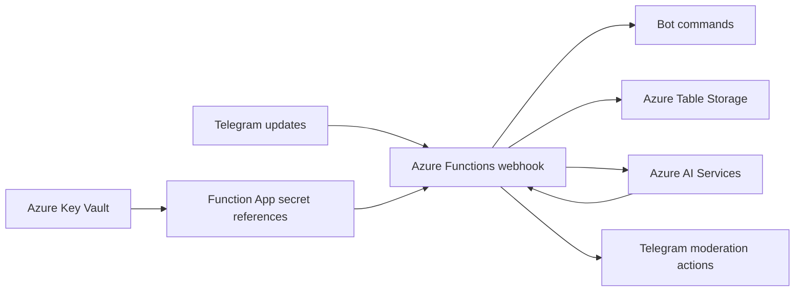

# Telegram Anti-Spam Bot

[](https://github.com/Dotron-Development/AntiSpamTelegramBot/actions/workflows/release-dev.yaml)
[](https://github.com/Dotron-Development/AntiSpamTelegramBot/actions/workflows/release-prod.yaml)

An AI-assisted moderation bot for Telegram supergroups, built with C# and .NET 10. It runs as an Azure Functions v4 isolated worker, detects spam in message text and photos, caches classification results in Azure Table Storage, and automatically moderates messages classified as spam.

Azure infrastructure and deployment are managed with Terraform and GitHub Actions. The repository contains the webhook application, AI integration, persistence layer, bot commands, webhook initializer, infrastructure definitions, and .NET tests.

## Features

- Processes new and edited Telegram messages through an HTTPS webhook.
- Validates Telegram's `X-Telegram-Bot-Api-Secret-Token` header before processing requests.
- Uses separate Azure AI model deployments for spam classification and text extraction from photos.
- Reuses cached spam and non-spam decisions using normalized message hashes.
- Deletes detected spam and restricts the sender for three hours.
- Queues new AI-detected spam for human review through function-key-protected APIs.
- Optionally forwards removed messages and AI explanations to a moderation archive chat.
- Tracks per-user message counts, daily and monthly deletion totals, and deletion latency.
- Provides the `/stat` command for chat-level moderation statistics.

## Architecture



The Function App uses a user-assigned managed identity to read Key Vault secrets and access Table Storage. Terraform configures Key Vault references for the Telegram token, webhook secret, and AI service API key. The AI client also supports Azure identity authentication when no API key is configured.

### Message processing

1. Validate the webhook secret and handle recognized commands.
2. Extract the new or edited message, excluding Telegram's channel-forwarding sender and the configured moderation archive chat.
3. Read the sender's recorded message count for that chat and increment it.
4. For a photo, resolve its Telegram file URL and extract image text using the image-analysis deployment.
5. Combine message text (or a photo caption) and extracted image text. Classification runs when the text exceeds 30 characters or a photo is present, and the sender has fewer than 100 previously recorded messages in that chat.
6. Normalize the combined content and check its SHA-256 hash in the classification cache.
7. On a cache miss, ask the spam-classification deployment for a probability. A score of at least 95 triggers moderation; lower scores are cached as non-spam.
8. For new AI-detected spam, save the original text/caption, image transcription, sender ID and display name, message ID, content hash, and original UTC message date as .NET ticks in `ProbablySpam` before moderation. Do not cache an AI-positive decision. Optionally forward the original message, delete it, restrict the sender for three hours, and update statistics. Cached human-confirmed spam triggers moderation without another review.

These thresholds are currently implemented in [AntiSpamBotWebHook.cs](src/bot/TelegramAntiSpamBot.Functions/AntiSpamBotWebHook.cs), rather than exposed as configuration settings. Classification errors are not treated as positive spam decisions.

### Message normalization and caching

AI receives the original combined text. The cache hash uses text processed by [MessageContentSanitizer.cs](src/bot/TelegramAntiSpamBot.Persistence/MessageContentSanitizer.cs); the review queue preserves the original text:

- Apply Unicode NFKC normalization and invariant lowercase conversion.
- Remove whitespace, supported emoji ranges, invisible formatting/control characters, and variation selectors.
- Replace sequences of Unicode decimal digits with a single Cyrillic `х` marker, regardless of number length.
- Preserve letters from different languages, diacritics, and other punctuation. Digit-to-letter substitutions are not normalized separately.

For example, `Hello 1000 world` and `hello 🔥 10001 world` produce the same normalized content and hash. SHA-256 is calculated over the UTF-16 encoded normalized text.

If normalization produces an empty string, classification and review bypass the hash cache so unrelated emoji-only messages do not share one decision. AI can cache only `false`; human review writes `true` or `false`. Cache entries use a stable partition (`1`) and the content hash as row key, so subsequent decisions replace the same entry. Existing records are not migrated.

### Stored data

| Azure table | Purpose |
|---|---|
| `SpamHash` | AI-safe and human-reviewed decisions keyed by normalized content hash. |
| `ProbablySpam` | Pending human review only; partition key is chat ID, row key is Telegram message ID. No probability or completed-review history is stored. |
| `MessageCount` | Recorded message counts per chat and sender. |
| `SpamStats` | Daily/monthly deletion totals and minimum, maximum, and average deletion latency. |
| `Chats` | Chat catalog: partition `chats`, row key is chat ID, with `Name` and UTC `LastSeenUtc`. Updated on incoming and edited messages, including commands; the configured archive chat is excluded. |

The four moderation tables are provisioned by Terraform through Azure CLI using Azure identity authentication; shared-key access is disabled for the application data storage account. `Chats` is created by the application on its first write if missing; Terraform is unchanged. The application identity needs table-creation permissions as well as entity read/write permissions. An absent catalog table reads as an empty list.

Persistence is split into table-specific repositories: `Chats`, `ProbablySpam`, `SpamHash`, `MessageCount`, and `SpamStats` each have their own interface and implementation. Consumers inject only the repositories they use; there is no shared all-table repository. Table schemas, partition/row keys, and existing records remain unchanged.

Chat registration is an awaited best-effort upsert before command processing and moderation, not a detached background task. Registration failures are logged separately and do not stop moderation. Names are refreshed on subsequent messages; existing chats are not backfilled without incoming traffic.

### Review API

All review endpoints require an Azure Functions key supplied in `x-functions-key` (or the `code` query parameter). They do not require Telegram's webhook secret. Function keys are normally not enforced by the local Functions host unless it is started with authentication enabled.

| Method and route | Input and behavior |
|---|---|
| `GET /api/review/chats` | Optional `pageSize` (1-1000, default 100) and opaque `continuationToken`. Returns `chats` (`chatId`, `name`, `lastSeenUtc`) and `continuationToken`. Follow tokens until null, including after an empty page. |
| `GET /api/review/messages?pageSize=100` | Optional non-zero `chatId` filters one chat's partition; omit it to query all chats. Optional `pageSize` (1-1000, default 100) and opaque `continuationToken`. Returns `messages` and `continuationToken`; request subsequent pages until the token is null. Results follow Azure Table Storage partition/row-key order, not date order. No chronological sorting or full-table aggregation is performed. |
| `POST /api/review/messages/{chatId}/{messageId}` | JSON body `{"isSpam":true}` or `{"isSpam":false}`. Updates `SpamHash` and removes the queued entry. For non-spam, first republishes the original text/caption and image transcription as plain text prefixed with `from: <display name>`. Long text is split across messages. No image is resent; no restrictions are lifted. Returns 204, or 404 if the entry is missing. |
| `POST /api/review/restrictions/{chatId}/{userId}` | No body. Independently restores the chat's default member permissions for this user. Returns 204, or 409 when default permissions are unavailable. |

Queue messages contain `chatId`, `messageId`, `userId`, `userName`, `message` (original text/caption), `imageText`, `contentHash`, and `messageDateTicks` (the original UTC date in .NET ticks). The date does not change during review. No `MessageHistory` table is used; completed reviews are not archived. Reviewers with a key have access to all chats and actions, without individual user roles.

Invalid inputs return 400. Review is not transactional across Table Storage and Telegram: failures can leave a queued entry after a cache update or partial publication. No deduplication, retry orchestration, or decision-locking mechanism is added; repeating a failed review can publish text again. Existing webhook error handling and Telegram redelivery behavior are unchanged.

### Bot commands

`/stat` displays the current chat's daily and monthly deletion totals and deletion-latency statistics. The bot removes the command message and deletes its statistics response after approximately 15 seconds. Commands also accept the configured bot-name suffix, such as `/stat@YourBotName`.

## Repository layout

| Path | Responsibility |
|---|---|
| [TelegramAntiSpamBot.Functions](src/bot/TelegramAntiSpamBot.Functions/) | Webhook endpoint, request authorization, message processing, and Telegram image URLs. |
| [TelegramAntiSpamBot.OpenAI](src/bot/TelegramAntiSpamBot.OpenAI/) | Azure AI clients, classification, image-text extraction, and embedded prompt instructions. |
| [TelegramAntiSpamBot.Persistence](src/bot/TelegramAntiSpamBot.Persistence/) | Table Storage repository, entities, statistics, and message normalization. |
| [TelegramAntiSpamBot.Commands](src/bot/TelegramAntiSpamBot.Commands/) | Command routing and `/stat`. |
| [TelegramAntispamBot.Configuration](src/bot/TelegramAntispamBot.Configuration/) | Telegram bot configuration model. |
| [TelegramAntiSpamBot.Initializer](src/bot/TelegramAntiSpamBot.Initializer/) | Console application that registers the Telegram webhook. |
| [Review web app](src/web/) | Local React interface for the review queue and restriction removal. |
| [Infrastructure](src/infrastructure/) | Azure resources, identities, networking, secrets, and environment variables. |
| [.NET tests](tests/TelegramAntiSpamBot.IntegrationTests/) | Message-normalization tests and a live AI service smoke test. |
| [Web tests](tests/TelegramAntiSpamBot.WebTests/) | Independent npm project with Playwright browser and CORS tests. |
| [GitHub workflows](.github/workflows/) | Development release, production/pre-production release, connectivity setup, cleanup, and infrastructure destruction. |

The shared target framework is defined in [Directory.Build.props](Directory.Build.props), and NuGet package versions are centralized in [Directory.Packages.props](Directory.Packages.props).

## Configuration

The application binds the following configuration sections. Use double underscores in environment variables to separate section and property names.

| Setting | Purpose |
|---|---|
| `TelegramBotConfiguration__Token` | Telegram bot token. Required. |
| `TelegramBotConfiguration__SecretHeader` | Shared webhook secret passed to Telegram when registering the webhook. Required. |
| `TelegramBotConfiguration__BotName` | Bot username including `@`, used for command suffix matching. Required. |
| `TelegramBotConfiguration__ForwardSpamToChatId` | Optional moderation archive chat ID. |
| `TelegramBotConfiguration__DebugAiResponse` | Enables AI explanations; defaults to `false`. |
| `OpenAiServicesConfiguration__ServiceUrl` | Azure AI service endpoint. Required. |
| `OpenAiServicesConfiguration__SpamRecognitionDeployment` | Spam-classification deployment name. Required. |
| `OpenAiServicesConfiguration__ImageRecognitionDeployment` | Image-text extraction deployment name. Required. |
| `OpenAiServicesConfiguration__ApiKey` | Optional AI API key; Azure identity authentication is used when omitted. |
| `OpenAiServicesConfiguration__OpenAiIdentityClientId` | Optional user-assigned identity client ID for AI access. |
| `AzureTablesConfiguration__StorageAccountUrl` | Azure Table Storage endpoint. Required. |
| `AzureTablesConfiguration__TableIdentityClientId` | Optional user-assigned identity client ID for Table Storage access. |

For local development, omitting identity client IDs allows `DefaultAzureCredential` to use an available developer identity. That identity needs Table Storage data permissions and, if API-key authentication is not used, access to the AI service.

## Local development

### Prerequisites

- .NET 10 SDK.
- Azure Functions Core Tools v4 with support for the project's .NET runtime.
- Azure CLI for developer authentication and infrastructure operations.
- Accessible Azure AI deployments and the four provisioned storage tables.
- A Telegram bot created through BotFather.
- A publicly accessible HTTPS endpoint or tunnel for Telegram webhook delivery.
- Local host storage, such as Azurite, when using `UseDevelopmentStorage=true`.

### Build

Run from the repository root:

```powershell
dotnet restore AntiSpamTelegramBot.sln
dotnet build AntiSpamTelegramBot.sln --configuration Release
```

### Run the Functions host

Configure [local.settings.json](src/bot/TelegramAntiSpamBot.Functions/local.settings.json) with your own values. The following is a placeholder example, not production configuration:

```json
{
  "IsEncrypted": false,
  "Values": {
    "AzureWebJobsStorage": "UseDevelopmentStorage=true",
    "FUNCTIONS_WORKER_RUNTIME": "dotnet-isolated",
    "TelegramBotConfiguration__Token": "<telegram-bot-token>",
    "TelegramBotConfiguration__SecretHeader": "<webhook-secret>",
    "TelegramBotConfiguration__BotName": "@YourBotName",
    "TelegramBotConfiguration__DebugAiResponse": "false",
    "OpenAiServicesConfiguration__ServiceUrl": "https://<ai-service-endpoint>/",
    "OpenAiServicesConfiguration__SpamRecognitionDeployment": "<spam-deployment>",
    "OpenAiServicesConfiguration__ImageRecognitionDeployment": "<image-deployment>",
    "OpenAiServicesConfiguration__ApiKey": "<ai-api-key>",
    "AzureTablesConfiguration__StorageAccountUrl": "https://<storage-account>.table.core.windows.net/"
  }
}
```

Do not commit real credentials. If using Azure identity authentication instead of an AI API key, omit the API-key setting and sign in with `az login`. For private Azure resources, the local machine must also have working network access and DNS resolution.

```powershell
Set-Location src\bot\TelegramAntiSpamBot.Functions
func start
```

The webhook route is `/api/AntiSpamBotWebHook`. Telegram must reach it through HTTPS; a localhost URL cannot receive Telegram updates directly.

### Run the review web app

With Node.js 24 LTS installed, run from the repository root:

```powershell
npm --prefix src/web ci
npm --prefix src/web run dev
```

Open the URL printed by Vite. The workspace automatically connects to the Function configured in `.env` and loads the chat catalog. Select a chat and load the queue. The English interface supports paginated review, original text and OCR, spam/not-spam decisions, and independent restriction removal.

Set `API_URL` and optional `FUNCTION_KEY` in the web app's `.env`. Restart Vite and reload after changes. There are no manual connection or credential controls. Requests go directly to the Function, so allow the exact frontend origin in its CORS settings. The key is not stored in browser storage, but a configured key is embedded in the client bundle: do not publish or share a bundle containing a real key. No web hosting or infrastructure is provisioned. See [the web app README](src/web/README.md) for connection details and action side effects, and [the independent Playwright project](tests/TelegramAntiSpamBot.WebTests/README.md) for browser tests.

### Register the webhook

Run the initializer from the repository root using your bot token, public HTTPS webhook URL, and shared secret:

```powershell
dotnet run --project src\bot\TelegramAntiSpamBot.Initializer -- "<telegram-bot-token>" "https://<public-host>/api/AntiSpamBotWebHook" "<webhook-secret>"
```

The initializer subscribes to new and edited message updates. Webhook registration replaces the bot's current webhook, so use a separate bot for development. Grant the bot permission to receive group messages, delete messages, and restrict members; disable Telegram privacy mode if needed for message delivery in your setup. The optional archive chat must also be accessible to the bot.

## Azure infrastructure

Terraform provisions:

- A resource group, virtual network, Functions subnet, and optional private-endpoint subnet.
- A Flex Consumption Function App, service plan, application storage, and Application Insights resource.
- Azure AI Services, separate classification/image deployments, and a content-filter policy.
- An application data storage account and four tables.
- An RBAC-enabled Key Vault containing `telegram-bot-token`, `telegram-bot-secret-header`, and `ai-services-api-key`.
- A user-assigned Function App identity and required role assignments.
- Permanent private endpoints for Key Vault and Table Storage when public access is disabled.
- Private DNS zones, VNet links, and temporary private endpoints for the self-hosted runner.

Environment settings are stored in [dev.tfvars](src/infrastructure/environments/dev.tfvars), [ppr.tfvars](src/infrastructure/environments/ppr.tfvars), and [prod.tfvars](src/infrastructure/environments/prod.tfvars). These configure resource naming, region, network ranges, model deployments, bot settings, and public-access behavior.

The Terraform configuration requires version `>= 1.17.0, < 2.0`; workflows install `1.17.0`. Provider constraints are defined in [versions.tf](src/infrastructure/versions.tf).

### Backend and runner prerequisites

The Azure Storage backend and GitHub runner VNet/subnet must already exist. Infrastructure jobs run on a self-hosted runner with Bash and Azure CLI available and access to the backend storage account. The Actions Runner must be version `2.327.1` or later for the Node.js 24 actions used by these workflows. Model deployments must be supported in the selected region and have sufficient quota.

All setup, deployment, cleanup, and destroy stages use the same state blob, `terraform.tfstate`, in the selected environment's backend container. `AZ_MAIN_STATE_FILE_KEY` is the name of that blob, not a separate state store. Terraform may store secret values in state even when variables are marked sensitive; restrict access to the backend and saved plans.

### Runner connectivity lifecycle

1. **Setup:** `setup-vm-runner-connectivity` sets `enable_runner_endpoints=true` and applies the targeted network dependencies, including DNS propagation waits. This bootstrap plan uses `-refresh=false`: the targets also include their Key Vault dependency, whose refresh reads certificate contacts through the data plane and can time out while runner connectivity is still disabled. Setup uses the saved state to restore connectivity before the main plan refreshes the Vault and its secrets.
2. **Deployment:** the main infrastructure job performs a full plan/apply. A separate job configures and refreshes Key Vault references using the Function App's user-assigned identity, followed by Function App publication and Telegram webhook registration.
3. **Cleanup:** a full, ordinary plan/apply with `enable_runner_endpoints=false` removes temporary runner endpoints and DNS waits. DNS records retain the permanent endpoint addresses.

The resource-targeting warning during setup is expected. Only this bootstrap plan disables refresh; the main deployment and cleanup retain normal refresh and full planning. Bootstrap relies on an accurate existing state and is not a substitute for reconciling external resource drift or making unrelated Key Vault changes.

Secrets, the Function App, and table provisioning do not depend on temporary runner endpoints. Cleanup does not use `terraform destroy -target` or manually remove Azure resources. Infrastructure-destroy workflows restore runner connectivity before planning a full destroy.

The default value of `enable_runner_endpoints` is `true`. CI, release, and destroy workflows use environment-specific concurrency groups to avoid overlapping operations on the same environment.

## GitHub Actions deployment

| Workflow | Trigger and purpose |
|---|---|
| [release dev](.github/workflows/release-dev.yaml) | Pushes to `main` or manual runs; deploys the `dev` environment. |
| [release prod](.github/workflows/release-prod.yaml) | Manual deployment to `ppr` or `prod`; `ppr` is the default selection. |
| [main-infrastructure](.github/workflows/main-infrastructure.yaml) | Reusable infrastructure workflow, including separate runner-connectivity setup and post-apply Key Vault reference configuration jobs. |
| [vm-runner-connectivity](.github/workflows/runner-connectivity.yaml) | Reusable setup/cleanup plan and apply controlled by `enable_runner_endpoints`. |
| [deploy](.github/workflows/functionapp.yaml) | Publishes the Linux Function App package, deploys it, and registers the webhook. |
| [cleanup-runner-endpoints](.github/workflows/cleanup-runner-endpoints.yaml) | Invokes connectivity cleanup after application deployment. |
| [destroy-ci](.github/workflows/destroy-ci.yaml) | Manual full infrastructure destruction for `dev`, `ppr`, or `prod`. |
| [destroy-infrastructure](.github/workflows/destroy-infrastructure.yaml) | Reusable connectivity setup followed by a full Terraform destroy plan/apply. |

Configure the following GitHub secrets at repository or environment scope:

| Secret | Purpose |
|---|---|
| `ARM_TENANT_ID` | Azure tenant ID. |
| `ARM_SUBSCRIPTION_ID` | Target Azure subscription. |
| `ARM_CLIENT_ID` | Deployment service principal application ID. |
| `ARM_CLIENT_SECRET` | Deployment service principal credential. |
| `AZ_OWNER_OBJECT_ID` | Object ID granted Key Vault administrator access. |
| `TELEGRAM_BOT_TOKEN` | Telegram bot token for the selected environment. |
| `TELEGRAM_BOT_SECRET_HEADER` | Telegram webhook secret for the selected environment. |

Configure the GitHub variables `AZ_TERRAFORM_BACKEND_STORAGEACCOUNT` and `AZ_TERRAFORM_BACKEND_RESOURCEGROUP` for the existing backend. Create the appropriate environment containers and configure the `dev`, `ppr`, and `prod` GitHub environments before deployment.

The deployment identity needs permission to manage the Azure resources, create role assignments, access Terraform state, and provision Key Vault secrets and storage tables. The application publish job runs on `ubuntu-latest`; infrastructure jobs use the self-hosted runner.

## Tests and validation

Run the deterministic normalization tests without contacting Azure:

```powershell
dotnet test tests\TelegramAntiSpamBot.IntegrationTests\TelegramAntiSpamBot.IntegrationTests.csproj --filter "FullyQualifiedName~MessageContentSanitizerTests"
```

The same test project contains a live AI smoke test. To run it, provide the required `appsettings.Test.json` in the test project directory with the `OpenAiServicesConfiguration` section and suitable authentication. The test loads .NET user secrets first and the JSON file afterward, so JSON values override matching user-secret keys. Keep credentials outside version control. Live AI calls require network access and may incur charges.

To run the entire .NET test project after configuring the live service:

```powershell
dotnet test tests\TelegramAntiSpamBot.IntegrationTests\TelegramAntiSpamBot.IntegrationTests.csproj
```

For static Terraform validation with the required providers installed:

```powershell
Set-Location src\infrastructure
terraform fmt -check
terraform validate
```

## Operational notes

- Telegram moderation requires suitable bot permissions in each supergroup. AI decisions can be incorrect; use the archive chat to review moderation results.
- Photo processing uses the largest available Telegram photo. The current pipeline uses `Message.Text` and extracted photo text; captions, documents, and other media are not separate classification inputs.
- Senders with at least 100 recorded messages bypass classification, although photo text extraction happens before that check.
- Logs can contain message content, AI explanations, and, at debug level, image URLs. Review log retention and access permissions before production use. Message text and photos are sent to the configured AI service.
- Cached decisions persist in Table Storage; changing model prompts or normalization does not automatically invalidate existing cache entries.
- Connectivity setup restores private access before refresh. If a previous deployment removed secrets or the Function App, rerun the corrected release workflow to recreate infrastructure and publish the application.
- The full destroy workflow removes persistent application infrastructure and data; it is not a substitute for runner-endpoint cleanup.
