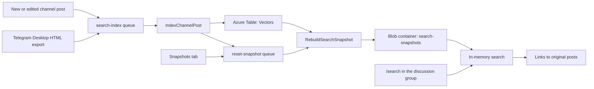

# Telegram channel post search

Use `/search async await` or `/search@BotName async await` in a channel's linked discussion group. The bot replies with up to five links to original channel posts. This is a slash command, not Telegram Inline Mode.

## 1. Indexing posts

- When Telegram automatically forwards a new or edited channel post to the discussion group, the [webhook](../src/bot/TelegramAntiSpamBot.Functions/Search/TelegramPostIndexJob.cs) gets the original channel and post IDs from `forward_origin`. It does not use the discussion copy's IDs. The post must have text or a media caption.
- For older posts, [ChannelArchiveImport](../tools/ChannelArchiveImport/ChannelArchiveImport.csproj) reads the channel's HTML export and sends jobs to the same queue. Start with a dry run, then send a test batch with `--limit 5`. See [import commands and access requirements](../README.md#one-off-telegram-archive-import).
- [IndexChannelPost](../src/bot/TelegramAntiSpamBot.Functions/Search/SearchIndexFunctions.cs) keeps the opening bold title when present and otherwise derives a title from the start of the text. It splits the post into chunks of up to 500 tokens, including the title prefix, and embeds them with `text-embedding-3-large` (3,072 dimensions).
- The `Vectors` table stores titles, metadata, and vectors, not full post text. Updates replace a post's vectors atomically; duplicate or stale jobs do not overwrite them. Queue messages, including those in `search-index-poison`, do contain source text.

## 2. Building a snapshot

After indexing, `IndexChannelPost` queues a `reset-snapshot` message with a one-minute delay. [RebuildSearchSnapshot](../src/bot/TelegramAntiSpamBot.Functions/Search/SnapshotFunctions.cs) reads one channel's data from `Vectors` and publishes a binary blob named `<channel-id>`, with no extension, in the private `search-snapshots` container. The snapshot contains a header with the `TCS1` signature, post metadata, vectors, and a SHA-256 checksum. A channel with no indexed posts does not produce a blob. The worker skips requests already covered by a newer snapshot.

To rebuild manually, open **Snapshots** in the review UI, select a discussion group, and click the upload icon. The bot resolves the linked channel. You can request a rebuild before the first snapshot exists. Refresh the status after the worker finishes.

## 3. Running a search

1. The [`/search` command](../src/bot/TelegramAntiSpamBot.Commands/Commands/SearchCommand.cs) gets the group's `linked_chat_id` from Telegram. [PostSearch](../src/bot/TelegramAntiSpamBot.Search/Query/PostSearch.cs) uses it to open the channel snapshot.
2. Each worker caches one snapshot of up to 160 MiB in memory. For repeated queries to the same channel, it checks the blob's `ETag` at most once every 30 seconds and does not download an unchanged snapshot again.
3. Search embeds the query and compares it with the chunks in memory using cosine similarity. Each post is ranked by its best chunk, with a boost when the title contains the full query. Only posts with a final score of at least 0.35 are eligible for the top five. Search does not use FAISS.
4. The bot replies in the same chat with links to original posts. Opening a link requires access to the channel. The bot also replies if the index is not ready or no results are found. In other cases where search cannot run, it deletes the command without replying if Telegram permits deletion.

## Troubleshooting a stale or missing index

- Check `search-index` and `reset-snapshot`, then their poison queues, `search-index-poison` and `reset-snapshot-poison`. Jobs move there after exhausting retries.
- If vectors are present but the blob is missing or stale, request a manual rebuild from **Snapshots**. Rebuilding reads existing vectors without generating new embeddings.
- The queues, `Vectors`, and `search-snapshots` are in the **data storage account**, not the separate Function App storage account.
